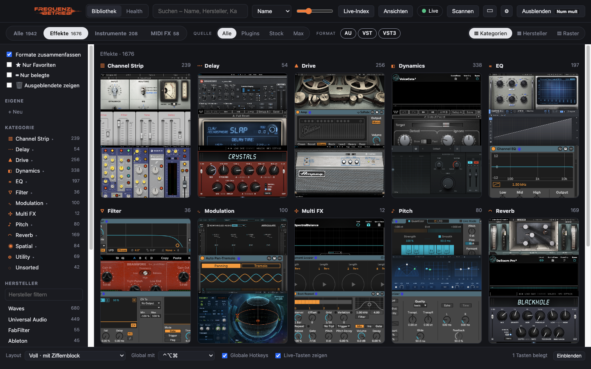

<p align="center">
  <a href="https://www.frequenzbetrieb.de"></a>
</p>

<h1 align="center">Plugin Organizer</h1>
<p align="center"><b>Plugins finden, sortieren und in Ableton Live laden</b> &middot; macOS (Windows teilweise)<br>
Ein kostenloses Open-Source-Projekt von <a href="https://www.frequenzbetrieb.de">Frequenzbetrieb n.e.V.</a></p>

<p align="center">
  <a href="../../actions/workflows/build.yml"></a>
  <a href="LICENSE"></a>
  <a href="https://www.frequenzbetrieb.de/spenden/"></a>
</p>



Der Plugin Organizer zeigt alle installierten Plugins, die Stock-Devices von Ableton Live und deine Max-for-Live-Devices als Kacheln **mit echtem Bild ihrer Oberfläche**. Ein Klick oder eine Taste lädt das Plugin direkt auf die ausgewählte Spur in Live – auf Wunsch auf eine neue Spur. Er läuft neben Live und greift nicht in den Signalweg ein.

## Funktionen

- **Bibliothek:** scannt AU, VST, VST3, AAX und CLAP inkl. Shell-Plugins (Waves), dazu Lives Stock-Devices und Max-for-Live-Devices aus User Library und Packs.
- **Racks & Presets:** Instrument-, Drum-, Effekt- und MIDI-Racks (.adg) sowie Device-Presets (.adv) aus User Library, Packs und Core Library – eigener Quellen-Reiter „Presets“, Presets zeigen das Bild ihres Devices, Laden per Klick/Taste wie bei Plugins.
- **Echte Vorschaubilder:** öffnet jedes Plugin unsichtbar und fotografiert die Oberfläche – AU über macOS, VST3 über einen eigenen kleinen Host (Steinberg VST3 SDK, macOS und Windows). VST2, Stock- und Max-Devices werden auf Wunsch direkt in Live aufgenommen („Live-Index“).
- **Sortierung:** Effekte / Instrumente / MIDI FX, automatische Kategorien mit Unterkategorien (z. B. Dynamics → Compressor, Limiter, De-esser …), Hersteller-Ansicht, Formate, Favoriten, eigene Sammlungen mit Farben, Mehrfachauswahl zum Umkategorisieren, Plugins ausblenden.
- **Laden in Ableton Live:** Klick auf eine Karte, ⇧-Klick für eine neue Spur. Der Organizer sucht in Lives Browser exakt das richtige Gerät (Lives eigene Plugin-Namen werden aus Lives Datenbank gelesen).
- **Tasten-Mapping:** Plugins auf Tasten legen (Layouts mit F-Tasten, Navigationsblock und Ziffernblock, Lives eigene Tasten markiert). Global mit ⌃⌥⌘ + Taste oder – nur solange Live vorne ist – mit der Taste allein. Pro Taste wählbar: auf ausgewählte oder neue Spur laden.
- **Health:** Speicherbedarf der Plugins, Intel-only-Plugins (Rosetta), nie genutzte Plugins, VST2-Duplikate, AAX ohne Pro Tools, Plugins aus deinen Live-Sets, die auf diesem Rechner fehlen.
- **Stream Deck:** eigenes Stream-Deck-Plugin – Plugin-Bild auf der Taste, ein Druck lädt das Plugin in Live (auf Wunsch auf neuer Spur). Download: [`Frequenzbetrieb-Plugin-Organizer.streamDeckPlugin`](https://github.com/Frequenzbetrieb/plugin-organizer/releases/latest/download/Frequenzbetrieb-Plugin-Organizer.streamDeckPlugin), Doppelklick installiert es; in der Elgato-Software die Aktion „Plugin laden“ (Kategorie Frequenzbetrieb) auf eine Taste ziehen und das Plugin suchen. Der Organizer muss laufen.
  - **Plugin-Browser auf dem Deck** (15 Tasten): Aktion „Browser öffnen“ wechselt in das mitgelieferte Profil „Frequenzbetrieb Browser“ – 12 Tasten mit Bild, rechts ◀ ▶ zum Blättern und ↩ zurück. Ebenen: Bereiche (Effekte, Instrumente, MIDI FX, Stock, Max, Presets, Favoriten, Sammlungen) → Kategorien → Unterkategorien → Plugins. Kurz drücken lädt auf die ausgewählte Spur, lang drücken auf eine neue.
- **Drei Ansichten:** Vollbild, **Sidecar** (schmale Leiste am Bildschirmrand neben Live, Kategorien als Bildstreifen) und **Mini** (kleines Suchfenster: tippen, ↑/↓, Enter lädt).
- **Fenster:** immer im Vordergrund, global per Taste ein-/ausblenden (Standard: Bild↑), nach dem Laden automatisch ausblenden.

## Download

**Direkt-Download der neuesten Version:** [macOS (Universal, DMG)](https://github.com/Frequenzbetrieb/plugin-organizer/releases/latest/download/Frequenzbetrieb-Plugin-Organizer-macOS-universal.dmg) · [Windows (Installer)](https://github.com/Frequenzbetrieb/plugin-organizer/releases/latest/download/Frequenzbetrieb-Plugin-Organizer-Windows-x64-Setup.exe) · [alle Versionen](../../releases). Jeder Commit wird zusätzlich automatisch gebaut; die Dateien liegen dann unter [Actions](../../actions) → letzter Lauf → *Artifacts*.

| System | Datei | Installation |
|---|---|---|
| macOS 13+ (Apple Silicon & Intel) | `…-macOS-universal.dmg` | DMG öffnen, App in „Programme“ ziehen |
| Windows 10/11 (x64) | `…-Windows-x64-Setup.exe` | Installer starten (oder die ZIP-Version entpacken) |

> Die Builds sind (noch) nicht signiert. macOS: einmalig
> `xattr -dr com.apple.quarantine "/Applications/Frequenzbetrieb Plugin Organizer.app"` ausführen.
> Windows: SmartScreen-Hinweis mit „Weitere Informationen → Trotzdem ausführen“ bestätigen.

**Unter Windows** funktionieren Bibliothek, Sortierung, Sammlungen, Health, das Laden in Live per Klick/Taste und echte Vorschaubilder für **VST3-Plugins** („Ansichten“). Der Live-Index (Bilder für VST2-, Stock- und Max-Devices) und „auf neuer Spur laden“ gibt es vorerst nur auf dem Mac.

## Selbst bauen & starten

Voraussetzungen: macOS 13 oder neuer, [Node.js](https://nodejs.org) ≥ 20, Xcode Command Line Tools (`xcode-select --install`) und Git.

```bash
git clone https://github.com/Frequenzbetrieb/plugin-organizer.git
cd plugin-organizer
npm install
npm start
```

Fertige App bauen: `npm run dist:mac` bzw. `npm run dist:win` (Ergebnis in `dist/`).

Beim ersten `npm start` werden die kleinen nativen Helfer gebaut (`bin/`): `au-snapshot` (Swift), `livecapture` (Swift) und `vst3-snapshot` (C++/Objective-C++, lädt dafür einmalig das [VST3 SDK](https://github.com/steinbergmedia/vst3sdk) nach `native/vst3sdk`).

> Hinweis zu npm ≥ 12: Install-Skripte sind standardmäßig gesperrt. Falls Electron nicht startet: `npm install-scripts approve electron` und `npm install` erneut ausführen.

### Berechtigungen (macOS)

- **Bedienungshilfen** – zum Laden in Live (Systemeinstellungen → Datenschutz & Sicherheit → Bedienungshilfen → „Electron“ bzw. Terminal aktivieren).
- **Bildschirmaufnahme** – nur für den Live-Index (Bilder von VST2-, Stock- und Max-Devices).

### Live-Index

Lädt jedes Plugin/Device ohne Bild nacheinander in Live, fotografiert es und macht das Laden über Lives Bearbeiten-Menü wieder rückgängig. Vorher ein leeres Live-Set öffnen und eine leere MIDI-Spur auswählen; für VST2 in Live „Plug-In-Fenster automatisch öffnen“ aktivieren. Ein kleines Monitorfenster zeigt den Fortschritt.

## Projektstruktur

| Pfad | Inhalt |
|---|---|
| `src/main.js` | Electron-Hauptprozess: Fenster, IPC, Hotkeys, Einstellungen |
| `src/scanner.js`, `src/taxonomy.js` | Plugin-Scan und Kategorisierung |
| `src/ableton.js`, `src/liveindex.js`, `src/livedb.js` | Steuerung von Ableton Live, Live-Index, Lives Plugin-Namen |
| `src/snapshots.js`, `src/health.js` | Vorschaubilder (AU/VST3), Library Health |
| `src/renderer/` | Oberfläche (HTML/CSS/JS, ohne Framework) |
| `native/snapshot.swift` | AU-Editor fotografieren |
| `native/vst3snap/` | Minimaler VST3-Host zum Fotografieren (`main.mm` macOS, `main_win.cpp` Windows) |
| `src/api.js` | Lokale Schnittstelle (nur 127.0.0.1, Schlüssel in `api.json`) für das Stream-Deck-Plugin |
| `streamdeck/` | Stream-Deck-Plugin (`src/plugin.js`, Property Inspector, `build.js`, Test mit nachgebautem Stream Deck) |
| `native/livecapture.swift` | Live-Fenster aufnehmen, Geräte erkennen (Vision), Live-Menüs |

Die Daten (Scan-Cache, Bilder, Einstellungen) liegen unter `~/Library/Application Support/Plugin Organizer/`.

## Mitmachen

Fehlermeldungen, Ideen und Pull Requests sind willkommen – über [Issues](../../issues) oder direkt als PR. Besonders gesucht: Tests mit anderen Live-Versionen und Sprachen, Windows-Unterstützung (VST3-Host und Live-Steuerung) und weitere DAWs.

## Lizenz

Der Plugin Organizer steht unter der **GNU Affero General Public License v3.0** ([LICENSE](LICENSE)). Du darfst ihn frei nutzen, verändern und weitergeben; veränderte Versionen müssen ebenfalls unter der AGPLv3 offen bleiben.

Verwendete Software: [Electron](https://www.electronjs.org) (MIT), [Steinberg VST3 SDK](https://github.com/steinbergmedia/vst3sdk) (MIT). Ableton und Ableton Live sind Marken der Ableton AG; VST ist eine eingetragene Marke der Steinberg Media Technologies GmbH. Dieses Projekt steht in keiner Verbindung zu Ableton oder Steinberg.

---

**Frequenzbetrieb n.e.V.** · [www.frequenzbetrieb.de](https://www.frequenzbetrieb.de) · [Spenden](https://www.frequenzbetrieb.de/spenden/)

<sub>English: Plugin Organizer is a free, open-source (AGPLv3) desktop app by the Frequenzbetrieb n.e.V. association. It lists your audio plugins plus Ableton Live's stock and Max for Live devices with real screenshots of their interfaces, organizes them into categories, collections and vendors, and loads them into Ableton Live with a click or a hotkey – optionally onto a new track. macOS; run with `npm install && npm start`.</sub>
